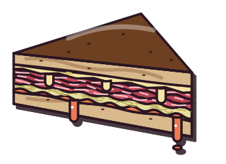

<p align="center">
  
</p>

<p align="center"><strong>The tastiest static site generator.</strong></p>

<p align="center">
  
</p>

Reuben builds websites from Markdown with [Rhai](https://rhai.rs) scripting stacked inside, reports every build error in one run, checks accessibility as it builds, and ships no JavaScript unless you add it.

```sh
cargo install reuben
```

Or add it to a Node project with `npm install --save-dev @reuben-ssg/reuben`.

## Repositories

- [**reuben**](https://github.com/reuben-ssg/reuben): the generator itself.
- [**docs**](https://github.com/reuben-ssg/docs): the documentation site at [reuben-ssg.dev](https://reuben-ssg.dev), built with Reuben.
- [**benchmarks**](https://github.com/reuben-ssg/benchmarks): how Reuben compares with Hugo and Zola on speed, memory and page weight.

Start with the [Quickstart](https://reuben-ssg.dev/quickstart/).

Made with love by [@nickvigilante](https://github.com/nickvigilante).
